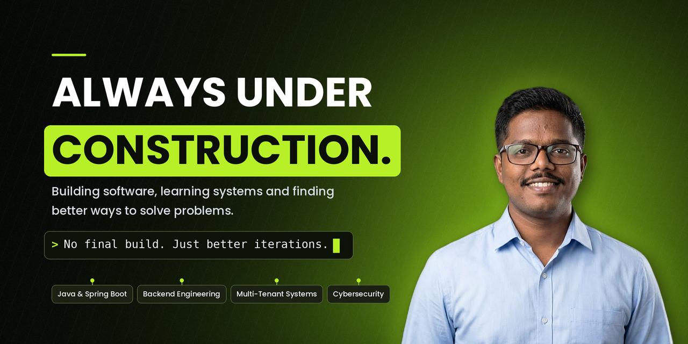

<div align="center">



<a href="https://github.com/SaikumarMadel">GitHub</a> ·
<a href="https://linkedin.com/in/saikumarmadel">LinkedIn</a>

</div>

## 💫 About Me

- 🎓 Computer Engineering Undergraduate (2026)
- 💼 IT Developer (Trainee) at ZDN Consulting Pvt. Ltd.
- 💻 Interested in Backend Engineering & Scalable Systems
- 🐳 Working with Docker, Linux, WSL & containerized services
- 🔐 Passionate about Cybersecurity & Secure Architectures
- ⚡ I enjoy debugging, optimization & understanding systems internally
- 🌱 Currently learning System Design, Cloud & Advanced Backend Development

### Featured Work

- **Unisphere ERP** *(private project)* — Full-stack college ERP for multi-role workflows, real-time activity, payments, AI assistance, and NBA/NAAC audit management.
  `React 19` · `Node.js` · `Express 5` · `MySQL` · `MongoDB` · `Socket.IO`
- **[Smart Task Manager API](https://github.com/SaikumarMadel/Smart-Task-Manager-API)** — Spring Boot 3 REST API with JWT roles, filtering, OpenAPI, tests, and CI.
- **[DevOps Toolkit](https://github.com/SaikumarMadel/DevOps_Toolkit)** — scripts for backing up, migrating, and deploying Node.js applications on an Ubuntu VPS.
- **[Nextcloud NAS](https://github.com/SaikumarMadel/Nextcloud-NAS)** — internship project at DIAT, Pune.

---

## 🛠️ Tech Arsenal

### Languages
<p>
  
</p>

### Application Development
<p>
  
</p>

### Databases
<p>
  
</p>

### DevOps & Cloud
<p>
  
</p>

### Tools & Platforms
<p>
  
</p>

### Unisphere ERP: Project Toolkit
```text
Real-time: Socket.IO                  Payments: Razorpay, Cashfree
AI: OpenAI API, Llama 3.1             Communication: Resend, Nodemailer, Google APIs
Reports: jsPDF, ExcelJS, XLSX          Maps: Mapbox GL
Security: JWT, bcrypt, CryptoJS
```

---

## 🌐 Connect With Me

<p align="center">
<a href="https://linkedin.com/in/saikumarmadel" target="blank">

</a>
</p>

<div align="center">

### ⚡ "Build systems. Solve problems. Keep learning."

Have a system worth untangling? <a href="https://linkedin.com/in/saikumarmadel/">Let's connect on LinkedIn.</a>

</div>
